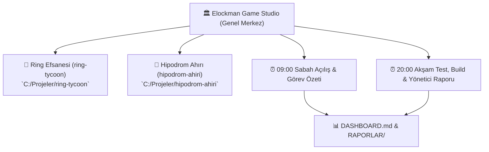

# 🎮 ELOCKMAN GAME STUDIO — Sanal Merkez Ofisi

**Elockman Game Studio**, stüdyo projelerimizin (Ring Efsanesi ve Hipodrom Ahırı) en üst düzey yönetim, otomasyon, kalite kontrol ve yayın süreçlerini koordine eden sanal genel merkezidir.

---

## 🏛️ Stüdyo Mimarisi ve Projeler

---

## 👥 Sanal Ofis Kadrosu (5 Çekirdek Departman)

Tüm departman kuralları ve sorumlulukları [`EKIP/`](file:///c:/Projeler/elockman-game-studio/EKIP) klasöründedir:
1. **[Studio Head (Genel Müdür)](file:///c:/Projeler/elockman-game-studio/EKIP/GENEL_MUDUR.md)**: Stüdyonun genel vizyonu, bütçe/öncelik onayı ve yüksek seviye koordinasyon.
2. **[Teknik Lider (Lead Architect & Dev)](file:///c:/Projeler/elockman-game-studio/EKIP/TEKNIK_LIDER.md)**: Kod mimarisi, sıfır-regresyon politikası, build stabilizasyonu.
3. **[Baş Oyun Tasarımcısı (Lead Game Designer)](file:///c:/Projeler/elockman-game-studio/EKIP/OYUN_TASARIMCISI.md)**: Boks/at yarış mekanikleri, drama sistemleri, oyun içi ekonomi ve denge.
4. **[QA & Test Şefi (QA Lead)](file:///c:/Projeler/elockman-game-studio/EKIP/QA_SEFI.md)**: 591+ testlik test otomasyonları, regresyon taramaları, canlı hata denetimi.
5. **[Sanat & Hikaye Yönetmeni (Art & Narrative Lead)](file:///c:/Projeler/elockman-game-studio/EKIP/SANAT_YONETMENI.md)**: Karakter anlatıları, atmosfer, UI/UX tasarımı ve görsel kimlik.

---

## ⏱️ Günlük Otomasyon ve Raporlama Döngüsü

- **09:00 (Sabah)**: `Güne Başlangıç & Görev Özeti` — Son git commit'leri, bekleyen TODO'lar ve sprint hedefleri.
- **20:00 (Akşam)**: `Test & Build Doğrulama ve Yönetici Kapanış Raporu` — Test koşuları, derleme durumu ve gün sonu özeti.
- Tüm raporlar anlık olarak [`DASHBOARD.md`](file:///c:/Projeler/elockman-game-studio/DASHBOARD.md) panosuna ve [`RAPORLAR/`](file:///c:/Projeler/elockman-game-studio/RAPORLAR) arşivine kaydedilir.
