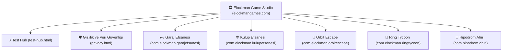

# 🎮 ELOCKMAN GAME STUDIO — Resmi Stüdyo & Portföy Genel Merkezi

**Elockman Game Studio**, mobil ve web ekosisteminde simülasyon, derin menajerlik stratejisi ve dinamik arcade dünyalar geliştiren bağımsız bir oyun stüdyosudur. Bu depo; stüdyo web portalını (`elockmangames.com`), kapalı test merkezini (`test-hub.html`) ve 5 aktif oyun projesinin merkezi yönetim standartlarını barındırır.

---

## 🏛️ Stüdyo Oyun Portföyü (5 Aktif Başlık)

| Oyun | Tür | Paket Adı | Web Sürümü | Google Play Kapalı Test |
| :--- | :--- | :--- | :--- | :--- |
| **🏎️ Garaj Efsanesi** | Simülasyon · Drag Yarışı | `com.elockman.garajefsanesi` | [Oyna ↗](https://garaj-efsanesi.onrender.com/) | [Teste Katıl ↗](https://play.google.com/apps/testing/com.elockman.garajefsanesi) |
| **⚽ Kulüp Efsanesi** | Spor · Futbol Menajerlik | `com.elockman.kulupefsanesi` | [Oyna ↗](https://kulup-efsanesi.onrender.com/) | [Teste Katıl ↗](https://play.google.com/apps/testing/com.elockman.kulupefsanesi) |
| **🚀 Orbit Escape** | Arcade · Fizik · Uzay | `com.elockman.orbitescape` | [Oyna ↗](https://orbit-escape-cprs.onrender.com/) | [Teste Katıl ↗](https://play.google.com/apps/testing/com.elockman.orbitescape) |
| **🥊 Ring Tycoon** | Boks Menajerliği · Tycoon | `com.elockman.ringtycoon` | [Oyna ↗](https://ring-tycoon.onrender.com/) | [Teste Katıl ↗](https://play.google.com/apps/testing/com.elockman.ringtycoon) |
| **🏇 Hipodrom Ahırı** | Atçılık · Yarış Simülasyonu | `com.hipodrom.ahiri` | [Oyna ↗](https://hipodrom-ahiri.onrender.com/) | [Teste Katıl ↗](https://play.google.com/apps/testing/com.hipodrom.ahiri) |

---

## 🌐 Stüdyo Mimarisi

---

## ⚡ 14 Günlük Google Play Kapalı Test Programı

Google Play'in 20 test kullanıcısı / 14 gün kesintisiz test gereksinimini koordine eden rehberli akış:
1. **Google Test Grubu**: [`elockman-testers@googlegroups.com`](https://groups.google.com/g/elockman-testers)
2. **Opt-in & Yükleme**: Her oyun için doğrudan Google Play test bağlantıları.
3. **Geri Bildirim Kanalı**: [`contact@elockmangames.com`](mailto:contact@elockmangames.com)

---

## 🛡️ Teknik & Politika Standartları
- **Android Uyumluluk**: `minSdk 24` (Android 7.0+ geniş erişim), `targetSdk 36` (Android 16 hazır).
- **Güvenlik & CSP**: `render.yaml` üzerinde `Content-Security-Policy`, `Strict-Transport-Security`, `X-Content-Type-Options`, `X-Frame-Options` kuralları aktiftir.
- **Sıfır Dış Bağımlılık**: Portal CSS ve JS varlıkları `self` kaynaklıdır; harici CDN kesintilerinden ve CSP engellemelerinden muaftır.
- **SEO & Schema**: Schema.org `Organization` ve 5 oyunluk `ItemList` (`VideoGame`) JSON-LD yapılandırılmış verisi entegredir.
- **İletişim**: `contact@elockmangames.com` | Geliştirici ID: `6034929488947548242`
